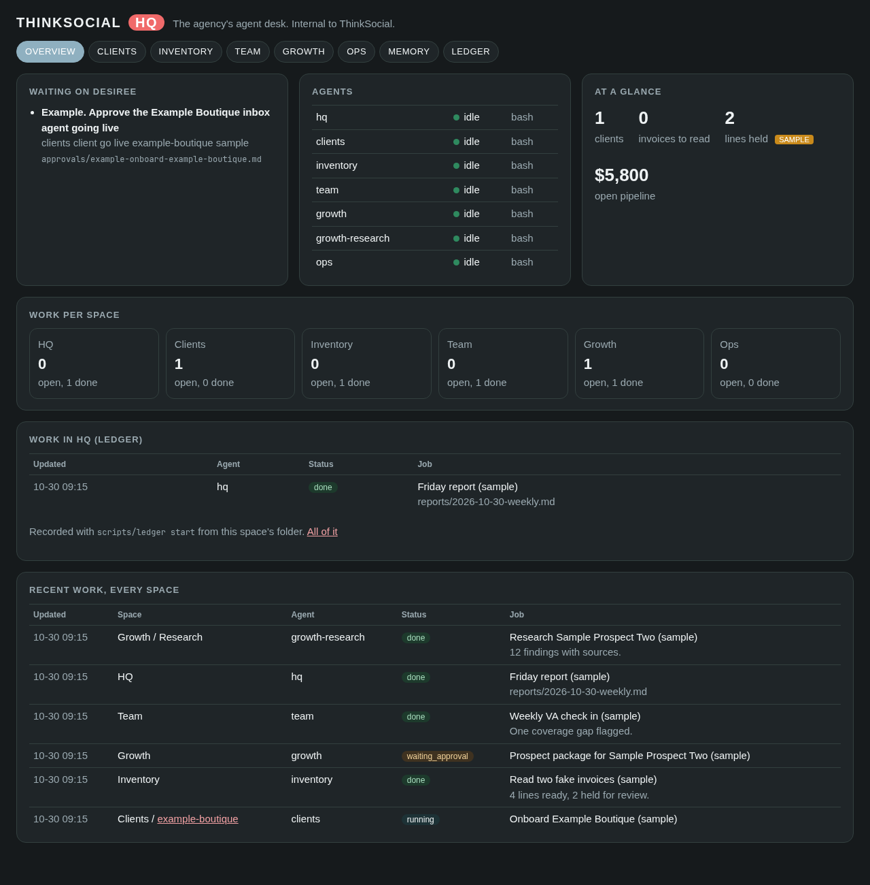
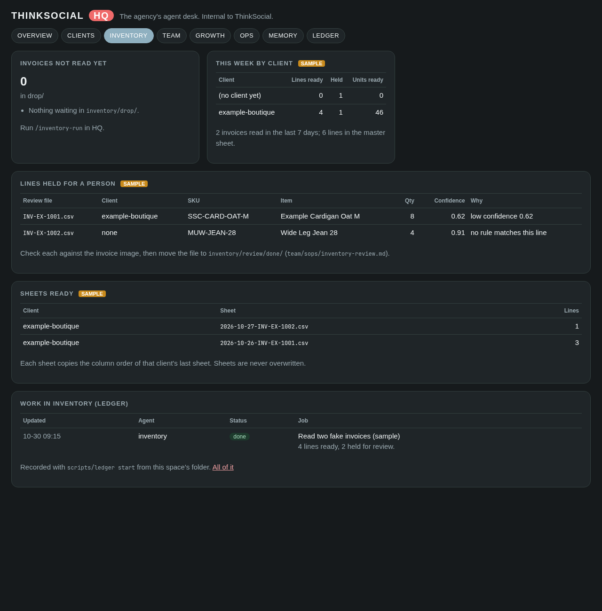

# ThinkSocial HQ

**An AI agent desk for running the agency.** Seven Claude Code agents work side by side on your computer: a manager called **HQ**, and one specialist for each part of the agency: **Clients**, **Inventory**, **Team**, **Growth** (with a research partner) and **Ops**. Each one has its own workspace and its own folder; `docs/layout.md` shows the map. You talk to HQ. HQ hands work to the right specialist, checks it, and brings you only finished work and clear questions.

Nothing is ever sent, posted, launched, spent, or changed in a client's store or inbox without your yes. The agents prepare everything and then ask.

Internal to ThinkSocial. Not for sharing outside the agency.

## What you get

* **HQ, the manager** (`CLAUDE.md`). Knows who does what, checks every agent before giving it work, never answers a question meant for you, keeps the work record, and writes the weekly agency report.
* **Clients** (`clients/`), the client space. One folder per client, made with one command: profile, platforms, contacts by role, plan and price, a support knowledge base, the inbox drafting agent's instructions, and folders for ads, reports, approvals and notes. A single table, `clients/INDEX.md`, lists every client with status, VA lead and next action. The clients agent runs onboarding checklists, builds knowledge bases, writes monthly client reports and keeps statuses current.
* **Inventory** (`inventory/`), the data entry work. Supplier invoices go in `inventory/drop/`. The inventory agent reads them (PDFs and photos), builds one master sheet, and makes each client's preference sheet in the exact format of the last one they received. Any line it is not sure of is held for a person. It never overwrites a sheet and never touches a store.
* **Team** (`team/`), VA operations. The roster, who covers which client, training and procedures (including how to use Front Desk: when to write a team note and when to escalate), a QA log, and a weekly VA check in.
* **Growth** (`growth/`), new business. Drop in a prospect's store link and you get the prospect package: research with sources, 10 sample ads, a proposal and a F.O.C.U.S. rundown of their customers' words. A pipeline table tracks every prospect. Outreach is drafted, never sent. The **Research** tab beside it only reads and reports.
* **Ops** (`ops/`), agency admin. The tool stack, the 1Password vault policy, contract and paperwork outlines, and a billing tracker.
* **Memory** (`memory/`). Facts and rules every agent reads at the start of every session. Each memory can be tagged to a space or to one client, and each space's instructions list the memories tagged to it. See `docs/memory.md`.
* **A work ledger** (`scripts/ledger`). A record of every job: who did it, in which space, for which client, what was asked, what came out. See `docs/ledger.md`.
* **Loops** (`docs/loops.md`). Status, client onboarding, client reports, the inventory run, the pipeline, the VA check in and the Friday report, each started with one command.
* **A dashboard** (`scripts/dashboard.py`). What is waiting on you, what each agent is doing, and one page per space: clients, inventory, team, growth, ops, memory and the ledger. Works on a phone.





## Setting up, step by step

You need a Windows 10 or 11 computer and a Claude account (Pro or Max plan) for Claude Code. Allow about 30 minutes.

### 1. Install WSL (Ubuntu on Windows)

Open **PowerShell as Administrator** (Start menu, type PowerShell, right click, Run as administrator) and run:

```
wsl --install -d Ubuntu
```

Restart when asked. Ubuntu opens and asks you to pick a username and password. Remember the password; Ubuntu asks for it when installing software.

From now on, every command goes in the **Ubuntu** window (Start menu, type Ubuntu).

### 2. Get ThinkSocial HQ

Clone it from the private ThinkSocial GitHub (ask Nelson to add your GitHub account first):

```
sudo apt-get update && sudo apt-get install -y git
cd ~
git clone https://github.com/thinksocialcontext/thinksocial-hq.git thinksocial-hq
cd thinksocial-hq
```

### 3. Run setup

```
./setup.sh
```

Setup checks what is installed and asks before installing each piece: basic tools (git, curl, Python, tmux, ImageMagick, jq), Node.js, Claude Code, the GitHub CLI (optional) and herdr (optional and recommended; free and open source; tmux does the same job if you skip it).

It also makes your private working files (the client list, roster, pipeline and billing tracker), copies the starter memories into `memory/`, and runs a quick self test. You can run it again any time; it only does what is still missing. To see what is installed without changing anything: `./setup.sh --check`.

### 4. Sign in to Claude Code

Open a new Ubuntu window and run `claude` once. Sign in with your Claude account, then type `/exit`.

### 5. Connect tools only when you need them

Every login and key lives in 1Password, one vault per client (`ops/vault-policy.md`). Connect a mailbox, a store or an ad account through Claude Code's connectors, read only first, one client at a time. Never paste a password or key into a chat with an agent.

## First run

```
scripts/hq start
```

This opens one workspace per space, each rooted at its own folder:

| herdr workspace / tab | Folder | Agent |
| --- | --- | --- |
| HQ | `./` | `hq` |
| Clients | `clients/` | `clients` |
| Inventory | `inventory/` | `inventory` |
| Team | `team/` | `team` |
| Growth | `growth/` | `growth` |
| Growth / Research | `growth/research/` | `growth-research` |
| Ops | `ops/` | `ops` |

* **With herdr:** run `herdr` first, then `scripts/hq start` inside it. You will see six workspaces: HQ, Clients, Inventory, Team, Growth and Ops. Growth has a second tab called Research.
* **With tmux:** run `scripts/hq attach`. There is one window per agent. Press **Ctrl+b** then a number (0 to 6) to switch. Press **Ctrl+b** then **d** to step away and leave them running.

The first time each agent starts, Claude Code asks whether you trust the folder. Answer yes for each one.

Go to the **hq** agent and type `/status`.

In a second Ubuntu window, start the dashboard and open http://localhost:8765 in your browser:

```
python3 scripts/dashboard.py
```

## Adding a client

```
scripts/new-client willow-and-pine --name "Willow and Pine"
```

This makes the client's folder from the template, their inventory folder and rules file, and a row in `clients/INDEX.md`. Then in HQ: `/client-onboard willow-and-pine`. Look at `clients/example-boutique/` to see a filled in (made up) client.

## Daily use

Talk to HQ in plain words. For example:

* "What needs me today?"
* "Onboard Willow and Pine. Their FAQ page is on their site; they do not want holding replies."
* "Read the invoices in the drop folder."
* "Who covers Willow and Pine this week?"
* "Here is a prospect: <their store link>. Build the package."
* "Remember: for Willow and Pine, exchanges only, no refunds after 14 days."

Or use the shortcuts:

| Type this in HQ | It does |
| --- | --- |
| `/status` | what needs you, what is blocked, what finished, by space |
| `/client-onboard <slug>` | makes the client's folder if needed and works the onboarding checklist |
| `/client-report <slug>` | writes that client's monthly report for you to review |
| `/inventory-run` | reads new invoices, builds the master sheet and client sheets, holds doubtful lines |
| `/pipeline` | reviews prospects and next steps, or builds a package from a store link |
| `/va-checkin` | the weekly VA check in: coverage, hours, QA |
| `/friday-report` | the weekly agency report |
| `/remember` | saves a fact or rule to memory, tagged to a space or a client |

### Approving things

When an agent needs a yes, it writes a file in `approvals/` and the dashboard shows it under **Waiting on Desiree**. Read it, then tell HQ "approved" or "no, change this", or edit the file's `status:` line yourself. Agents act only on a clear yes to that exact item.

### Stopping for the day

Agents can keep running. To close them all (tmux): `scripts/hq stop`. With herdr, close the workspaces in herdr.

## Keeping data private

* Client folders, invoices, sheets, the roster, the pipeline, billing, memory, the ledger, approvals and reports all stay on this computer and are ignored by git.
* The repository holds only the system itself, the empty templates and one made up example client.
* Logins live in 1Password. Never in a file, a chat or a memory.

## For the curious

* `docs/layout.md` which workspace works in which folder, and how each is tied to memory and the ledger
* `docs/memory.md` how agents remember
* `docs/ledger.md` the work record
* `docs/loops.md` the repeating jobs
* `docs/herdr-and-tmux.md` how the agents run side by side
* `tests/run.sh` the self tests (`bash tests/run.sh`)
